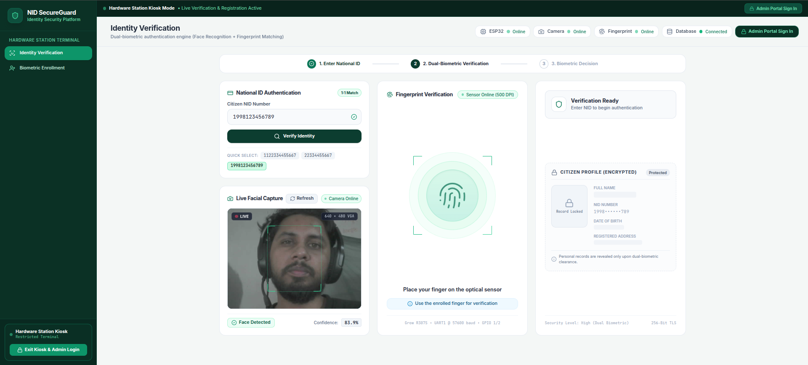
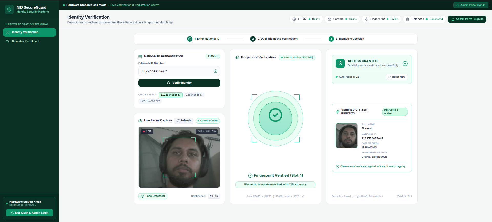
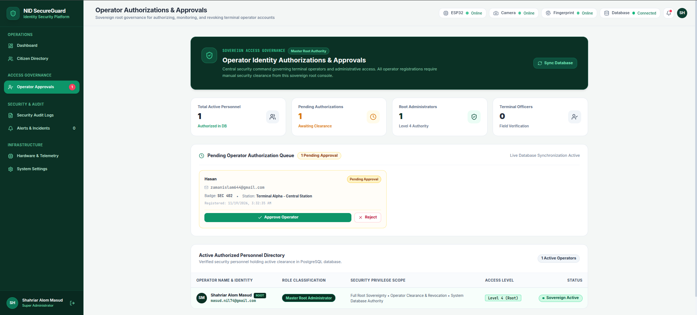
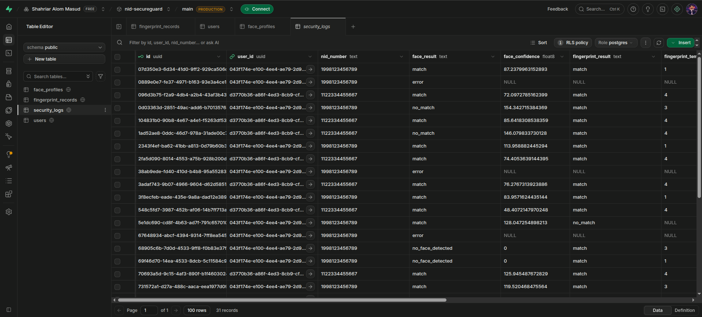
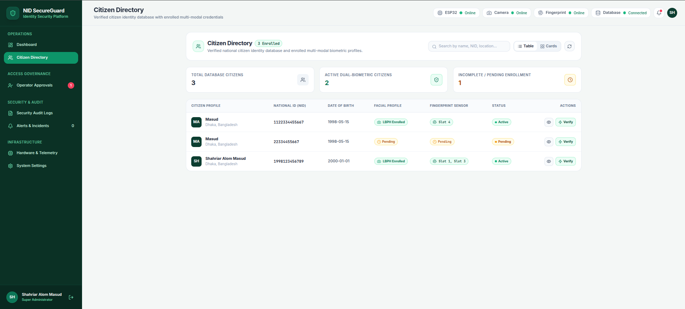
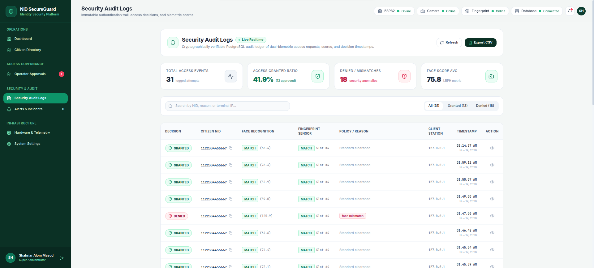
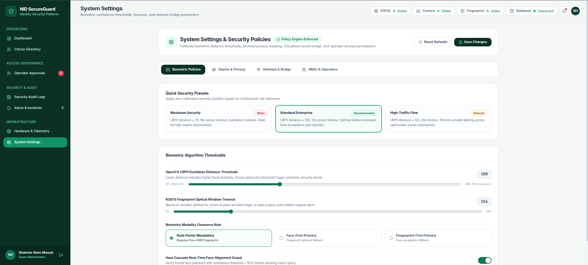
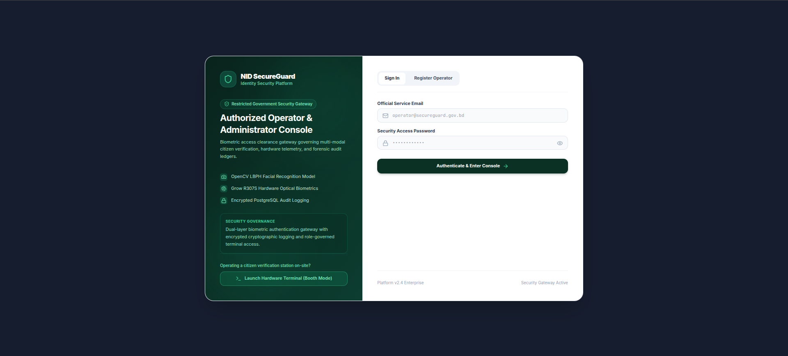
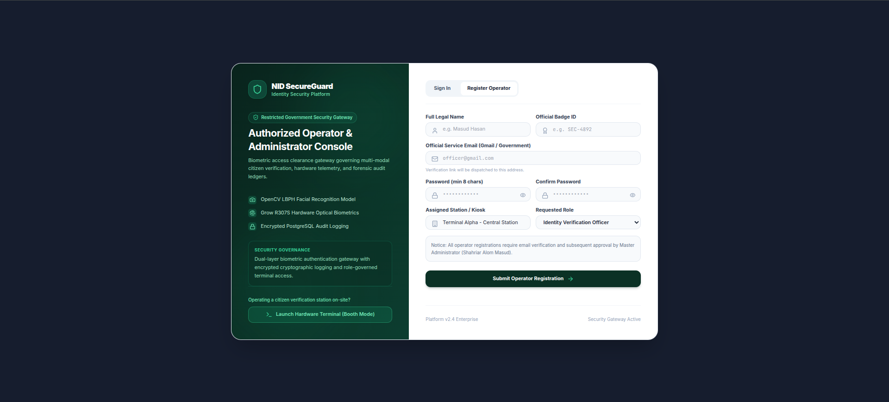

# NID SecureGuard: A Cyber-Physical Multi-Modal Biometric Verification Architecture with Hardware HMAC Authentication and Tamper-Evident Audit Chaining

[](https://fastapi.tiangolo.com)
[](https://reactjs.org)
[](https://www.typescriptlang.org)
[](https://tailwindcss.com)
[](https://supabase.com)
[](https://www.espressif.com)
[](https://opencv.org)
[](https://nid-secureguard-dashboard.onrender.com)
[](https://www.python.org)
[](https://opensource.org/licenses/MIT)

> **An end-to-end Cyber-Physical National Identity Verification and Access Control Platform coupling high-speed edge hardware (ESP32-S3, OV2640 camera DMA, Grow R307S optical fingerprint sensor) with an OpenCV LBPH facial recognition engine, Supabase PostgreSQL audit ledger, sovereign root operator governance, and standalone hardware booth kiosk isolation.**

> [!IMPORTANT]
> **Live Production Deployments:**
> - **Kiosk & Administrative Dashboard:** [https://nid-secureguard-dashboard.onrender.com](https://nid-secureguard-dashboard.onrender.com)
> - **Central Processing & Security API:** [https://nid-secureguard-api.onrender.com](https://nid-secureguard-api.onrender.com)
> - **API Health & Edge Hardware Probe:** [https://nid-secureguard-api.onrender.com/health](https://nid-secureguard-api.onrender.com/health)

> [!NOTE]
> **Complete Visual Demonstration Gallery:** For the complete 14-asset visual showcase—including full-resolution hardware station kiosk screens, dual-biometric enrollment studio, forensic security audit inspector, live ESP32-S3 FreeRTOS telemetry diagnostics, and physical silicon breadboard photographs—see the [Complete Visual Demonstration Gallery (Section 12)](#12-complete-visual-demonstration-gallery-all-14-assets).

---

## Table of Contents

1. [Key Features](#1-key-features)
2. [Master System Architecture](#2-master-system-architecture)
3. [How the System Works (Operational Pipeline)](#3-how-the-system-works-operational-pipeline)
   - [National Identity Query & Standby Clearance](#31-national-identity-query--standby-clearance)
   - [Optical Fingerprint Matching Pipeline](#32-optical-fingerprint-matching-pipeline)
   - [Facial Detection & LBPH Recognition Pipeline](#33-facial-detection--lbph-recognition-pipeline)
   - [Dual-Biometric Clearance Decision Formulation](#34-dual-biometric-clearance-decision-formulation)
   - [Sovereign Master Admin & Operator Authorization Matrix](#35-sovereign-master-admin--operator-authorization-matrix)
4. [Computer Vision & Biometric Algorithms](#4-computer-vision--biometric-algorithms)
5. [Embedded Hardware Layer (ESP32-S3 Cyber-Physical Edge)](#5-embedded-hardware-layer-esp32-s3-cyber-physical-edge)
6. [Hardware Station Kiosk Mode & Booth Isolation](#6-hardware-station-kiosk-mode--booth-isolation)
7. [Cryptographic Security Architecture & Data Protection](#7-cryptographic-security-architecture--data-protection)
   - [Field-Level AES-256-GCM Encryption](#71-field-level-aes-256-gcm-encryption-data-at-rest)
   - [Deterministic Blind Indexing](#72-deterministic-blind-indexing)
   - [Hardware HMAC-SHA256 Handshake & Replay Guard](#73-hardware-hmac-sha256-handshake--replay-guard)
   - [Tamper-Evident Cryptographic Audit Ledger](#74-tamper-evident-cryptographic-audit-ledger)
8. [Installation & Local Setup Guide](#8-installation--local-setup-guide)
9. [Automated Verification & Security Test Suite](#9-automated-verification--security-test-suite)
10. [Cloud Deployment Architecture (Render.com)](#10-cloud-deployment-architecture-rendercom)
11. [Project & Repository Structure](#11-project--repository-structure)
12. [Complete Visual Demonstration Gallery (All 14 Assets)](#12-complete-visual-demonstration-gallery-all-14-assets)
13. [Author & Contact Information](#13-author--contact-information)
14. [License](#license)

---

## 1. Key Features

- **Dual-Modal Biometric Fusion:** Implements true two-factor physical biometric verification—requiring simultaneous convergence of an optical fingerprint hash (Grow R307S) and an OpenCV Local Binary Patterns Histograms (LBPH) facial recognition confidence threshold ($\le 85.0\text{ Euclidean}$).
- **FreeRTOS Dual-Core Asymmetric Task Separation:** ESP32-S3 firmware delegates high-speed DVP DMA camera streaming and HTTP API synchronization to **Core 0** while dedicating **Core 1** to non-blocking UART fingerprint sensor handshakes, GPIO indicator drivers, and a hardware Watchdog Timer (WDT).
- **Field-Level AES-256-GCM Encryption & Blind Indexing:** Encrypts sensitive citizen personal data (addresses, phone numbers, contact profiles) with authenticated Galois/Counter Mode cryptography. Enables rapid $O(1)$ database query capabilities via deterministic HMAC-SHA256 blind indexing without leaking plaintext identifiers.
- **Hardware-to-Cloud HMAC-SHA256 Anti-Spoofing & Replay Guard:** Enforces cryptographic hardware integrity checks via ESP32 `mbedtls` SHA256 HMAC digital signatures and a strict drift freshness window on every frame, sensor ping, and biometric match result.
- **Tamper-Evident Hash-Chained Audit Ledger:** Links consecutive forensic security logs into an immutable cryptographic hash chain ($H_i = \text{SHA256}(H_{i-1} \parallel \text{Canonical}(L_i))$) with HMAC-SHA256 digital seals, exposing unauthorized database tampering mathematically.
- **Standalone Hardware Station Kiosk Mode:** Operates as a public-facing citizen verification booth out of the box. Automatically locks down the user interface to **Identity Verification** and **Biometric Enrollment**, preventing unauthorized access to administrative directories or telemetry consoles.
- **Sovereign Master Root Access Governance:** Centralized database-backed authorization matrix under Master Root Administrator (`masud.nil74@gmail.com`). Newly registered operators must verify their official Gmail address and await explicit cryptographic root clearance before console access is unlocked.
- **On-Demand Biometric Enrollment Studio:** Step-by-step multi-modal citizen onboarding featuring 5-frame facial training sample extraction, automatic LBPH model retraining, and R307S optical flash template allocation.
- **Real-Time Security Alarms & Incident Management:** Dynamic forensic incident scanner monitoring failed attempts, threshold violations, and hardware sensor telemetry with CSV audit exports and 1-click investigator dossier inspection.
- **Cloudflare Ingress Bridge:** Secure encrypted reverse-proxy tunneling routing edge ESP32 hardware telemetry over cellular hotspots without opening vulnerable inbound firewall ports.

---

## 2. Master System Architecture

```
+---------------------------------------------------------------------------------------------------+
|                                     MASTER SYSTEM TOPOLOGY                                        |
|                                                                                                   |
|  [ Physical Citizen at Booth ]                                                                    |
|             |                                                                                     |
|             v                                                                                     |
|  +---------------------------------------------------------------------------------------------+  |
|  |                              ESP32-S3 Cyber-Physical Edge Layer                             |  |
|  |  • Core 0: Wi-Fi Station, DVP DMA Camera Streamer (OV2640, SVGA/VGA @ 15-20 FPS)            |  |
|  |  • Core 1: UART1 Sensor Handshake (Grow R307S @ 57600 baud), GPIO 38/39 Indicator Drivers    |  |
|  |  • Task Watchdog Timer (WDT 5000ms), 8 MB Octal PSRAM, 16 MB Quad Flash                     |  |
|  +---------------------------------------------------------------------------------------------+  |
|             |                                           |                                         |
|    DVP JPEG HTTP Stream                       UART Template Verification                          |
|             |                                           |                                         |
|             v                                           v                                         |
|  +---------------------------------------------------------------------------------------------+  |
|  |                             FastAPI Central Processing Gateway                              |  |
|  |  • OpenCV LBPH Face Recognizer Engine (CascadeClassifier + cv2.face.LBPHFaceRecognizer)    |  |
|  |  • R307S Fingerprint Bridge & Template Score Assessor                                       |  |
|  |  • Dual-Biometric Fusion Evaluator (Threshold tau <= 85.0)                                  |  |
|  |  • Operator Governance API (/api/v1/operators/pending, /approve, /reject)                   |  |
|  +---------------------------------------------------------------------------------------------+  |
|             |                                           |                                         |
|             v                                           v                                         |
|  +-------------------------------------+     +-------------------------------------------------+  |
|  |         Supabase Cloud DB           |     |         React 19 + TypeScript Console           |  |
|  |  • PostgreSQL Relational Tables:   |     |  • Hardware Station Kiosk (Default Landing)     |  |
|  |    users, face_profiles,            |     |  • System Dashboard & Live Camera HUD View      |  |
|  |    fingerprint_records, logs        |     |  • Citizen Directory & Profile Dossier Inspector|  |
|  |  • Storage Bucket: face-samples    |     |  • Forensic Audit Ledger & CSV Export           |  |
|  |  • Auth User Metadata (RBAC)        |     |  • Sovereign Operator Authorization Queue       |  |
|  +-------------------------------------+     +-------------------------------------------------+  |
+---------------------------------------------------------------------------------------------------+
```


---

## 3. How the System Works (Operational Pipeline)

```
Citizen NID Lookup ──► Optical Fingerprint ──► Live Face Capture ──► Dual Fusion Engine ──► Clearance Decision
```

### 3.1 National Identity Query & Standby Clearance
When a citizen steps up to the verification station, they provide their registered National Identification Number (NID). The kiosk initiates an asynchronous lookup against the encrypted citizen database:
$$\text{CitizenProfile} = \text{Lookup}(\text{NID}) \quad \text{where } \text{NID} \in \text{DB}_{\text{citizens}}$$

If the citizen record is present, the terminal unlocks the optical fingerprint reader and live camera viewport. If unregistered, the system presents an immediate **On-Site Citizen Enrollment** prompt to capture biographical data and live biometrics.

### 3.2 Optical Fingerprint Matching Pipeline
The citizen places their finger onto the Grow R307S optical prism (500 DPI resolution, 256-byte template buffer). The sensor digitizes the ridge minutiae, computes the optical hash, and executes an on-chip search against the stored template ID:
$$\text{Match}_{\text{fp}} = \begin{cases} 
\text{True}, & \text{if } \text{Confidence}_{\text{score}} \ge 100 \text{ and } \text{ID}_{\text{sensor}} = \text{ID}_{\text{citizen}} \\
\text{False}, & \text{otherwise}
\end{cases}$$

### 3.3 Facial Detection & LBPH Recognition Pipeline
Concurrently, the ESP32-S3 camera streams live video frames ($640 \times 480\text{ VGA}$ or $800 \times 600\text{ SVGA}$) via direct memory access (DMA). The OpenCV backend:
1. Converts the frame to grayscale and equalizes image histogram variance:
   $$I_{\text{eq}} = \text{EqualizeHist}(\text{Grayscale}(I))$$
2. Detects the primary facial bounding box using a tuned Haar Cascade detector:
   $$\text{ROI}_{\text{face}} = \text{HaarCascade}(I_{\text{eq}})$$
3. Computes the Local Binary Patterns Histograms (LBPH) Euclidean distance against the trained model:
   $$D_{\text{euclid}} = \sqrt{\sum_{i=1}^{B} (H_{\text{live}}(i) - H_{\text{model}}(i))^2}$$

### 3.4 Dual-Biometric Clearance Decision Formulation
Access is granted if and only if **both** physical biometric modalities satisfy strict clearance criteria:

$$\text{Decision} = \begin{cases} 
\mathbf{GRANTED}, & \text{if } \text{Match}_{\text{fp}} = \text{True} \;\land\; D_{\text{euclid}} \le \tau_{\text{face}} \\
\mathbf{DENIED},  & \text{otherwise}
\end{cases}$$

Where the calibrated default threshold is $\tau_{\text{face}} = 85.0\text{ Euclidean}$ (tunable via System Settings between $65.0$ and $125.0$). 

Upon a `GRANTED` decision:
- ESP32 Core 1 pulses **GPIO 38** (Green LED Active) for $3000\text{ ms}$.
- Display renders authenticated citizen biographical credentials and issuance seals.
- Full forensic record is appended to the `security_logs` ledger.

Upon a `DENIED` decision:
- ESP32 Core 1 pulses **GPIO 39** (Red LED Active) with an alarm buzzer chime.
- Real-time incident alert is dispatched to the **Alerts & Incidents** command desk.

### 3.5 Sovereign Master Admin & Operator Authorization Matrix
The platform implements an institutional security governance hierarchy:
- **Master Root Sovereign (`masud.nil74@gmail.com`):** Holds permanent root administrative sovereignty. Holds exclusive authority to authorize, promote, or purge operator applicants.
- **Operator Registration Gate:** Newly onboarded field officers must register with their official email, verify their inbox confirmation token, and await manual approval from the Master Administrator.
- **Zero-Bypass Architecture:** Even when an operator confirms their email, the frontend and backend security gates strictly block console access (`isApproved == false`), isolating them on an **Account Pending Authorization** lock screen until root clearance is recorded in the database.

---

## 4. Computer Vision & Biometric Algorithms

### Local Binary Patterns Histograms (LBPH) Mathematical Formulation
The LBPH face recognizer operates by thresholding the $3 \times 3$ neighborhood around each pixel with the center pixel value, treating the result as an 8-bit binary number:

$$\text{LBP}(x_c, y_c) = \sum_{p=0}^{P-1} s(i_p - i_c) \cdot 2^p, \quad \text{where } s(x) = \begin{cases} 1, & x \ge 0 \\ 0, & x < 0 \end{cases}$$

Here, $i_c$ represents the intensity of the central pixel, $i_p$ denotes the intensities of the $P=8$ surrounding equidistant neighbors, and $R=1$ is the spatial radius. The resulting spatial texture map is divided into $8 \times 8$ local grid cells, from which histograms $H_j$ are extracted and concatenated into a global feature vector.

### Optical Fingerprint Minutiae Matching
The Grow R307S optical sensor features an onboard 32-bit DSP running proprietary feature extraction algorithms. It converts optical light reflected off finger epidermal friction ridges into a standardized 512-byte character buffer (`CharBuffer1` and `CharBuffer2`), subsequently synthesised into a flash template file. Verification matches the query buffer against stored templates using Euclidean distance between ridge bifurcations and ridge endings.

---

## 5. Embedded Hardware Layer (ESP32-S3 Cyber-Physical Edge)

### Hardware Pin Mapping & GPIO Matrix
| Component / Peripheral | Hardware Interface | ESP32-S3 Physical Pin | Operational Characteristics |
| :--- | :--- | :--- | :--- |
| **OmniVision OV2640** | DVP 8-bit Parallel DMA | GPIO 11–18 (D0–D7), GPIO 10 (PCLK), GPIO 9 (VSYNC), GPIO 8 (HREF) | 15–20 FPS Video Streaming, SVGA/VGA Mode |
| **OV2640 SCCB Control** | I2C Protocol | GPIO 4 (SDA), GPIO 5 (SCL) | Camera Configuration & Exposure Registers |
| **Grow R307S Sensor** | Hardware UART1 | GPIO 1 (ESP32 TX -> R307 RX), GPIO 2 (ESP32 RX -> R307 TX) | 57600 Baud, 3.3V Logic Level Interfacing |
| **Clearance Indicator** | External Digital Out | GPIO 38 | Active-HIGH Drive for Green LED / Relay Access Lock |
| **Rejection Indicator**| External Digital Out | GPIO 39 | Active-HIGH Drive for Red LED / Security Audible Buzzer |
| **Power Management**   | LDO Voltage Regulator | 5V / 3.3V Rail | Dedicated 2A External Power Supply |

### FreeRTOS Dual-Core Task Allocation
- **Core 0 (Network & Ingress Task):**
  - Manages Wi-Fi 802.11 b/g/n station connection and reconnection routines.
  - Serves direct HTTP JPEG multipart stream at `http://<device_ip>:81/stream`.
  - Transmits periodic JSON health telemetry heartbeats (heap space, uptime, Wi-Fi RSSI) every $5000\text{ ms}$.
- **Core 1 (Sensory & Real-Time Actuation Task):**
  - Executes non-blocking UART frame listener polling for R307S finger detection interrupt.
  - Controls GPIO 38/39 indicator drive with hardware millisecond timers.
  - Services FreeRTOS Task Watchdog Timer (`esp_task_wdt_reset()`) to guarantee autonomous recovery from bus hangs.

---

## 6. Hardware Station Kiosk Mode & Booth Isolation

To guarantee physical station security when deployed in public civic centers or immigration border points, the frontend implements an autonomous **Hardware Station Kiosk Mode**:

- **Default Landing Point:** The application initializes directly into the **Identity Verification Booth** (`VerificationKiosk.tsx`). Citizen service operates continuously without requiring administrative logins.
- **Strict Sidebar Isolation:** When running in booth mode, administrative directories (System Dashboard, Citizen Directory, Security Audit Logs, Alerts, Telemetry, System Settings, Operator Approvals) are stripped from the DOM and blocked by route guards.
- **Accessible Kiosk Routes:** Only two operational routes are permitted during booth mode:
  1. `Identity Verification` — Citizen NID lookup, camera HUD, and optical fingerprint verification.
  2. `Biometric Enrollment` — Live on-site citizen capture when an unregistered citizen appears at the booth.
- **Admin Console Gateway:** An **[Admin Portal Sign In]** action positioned in the top header and sidebar footer provides an authenticated gateway for authorized personnel to enter credentials and transition into the administrative console.

---

## 7. Cryptographic Security Architecture & Data Protection

NID SecureGuard enforces an enterprise defense-in-depth cryptographic model protecting citizen PII, embedded edge hardware, and the central forensic audit ledger:

```
+---------------------------------------------------------------------------------------------------+
|                                 CRYPTOGRAPHIC SECURITY ARCHITECTURE                               |
|                                                                                                   |
|  [ ESP32 Edge Device ]                                                                            |
|        |                                                                                          |
|        |-- SHA256 HMAC Signature: X-Device-Signature = HMAC-SHA256(Payload || Timestamp, Secret)  |
|        |-- Replay Protection: |T_server - T_device| <= 120s                                        |
|        v                                                                                          |
|  [ FastAPI Security Gateway ]                                                                     |
|        |                                                                                          |
|        |-- Sovereign Master Root RBAC: Bearer JWT validation (masud.nil74@gmail.com)              |
|        |-- Field-Level Encryption: Ciphertext = AES-256-GCM(Plaintext, IV_96bit, Key_256bit)     |
|        |-- Deterministic Blind Index: NID_hash = HMAC-SHA256(NID, Pepper_Key)                     |
|        |-- Cryptographic Audit Seal: Sig = HMAC-SHA256(Canonical(Log), Audit_Secret)             |
|        |-- Hash Chain: ChainHash_i = SHA256(ChainHash_{i-1} || Canonical(Log_i))                  |
|        v                                                                                          |
|  [ Supabase PostgreSQL Storage ]                                                                  |
|        |-- Encrypted PII: enc:v1:<base64(Nonce || Ciphertext || AuthTag)>                         |
|        |-- Tamper-Evident Security Log Ledger with verify-chain probe                             |
+---------------------------------------------------------------------------------------------------+
```

### 7.1 Field-Level AES-256-GCM Encryption (Data at Rest)
Citizen Personally Identifiable Information (PII) is encrypted at the application boundary prior to PostgreSQL database persistence:
$$\text{Ciphertext}, \text{Tag} = \text{AES-256-GCM}_{\text{Encrypt}}(K_{\text{enc}}, \text{IV}_{96\text{bit}}, \text{Plaintext})$$
- **Nonce / IV Hygiene:** Every field encryption generates a fresh, non-repeating 96-bit cryptographically secure random nonce (`os.urandom(12)`).
- **Format Envelope:** Serialized as `enc:v1:<base64(Nonce + Ciphertext + Tag)>`.
- **Integrity Tag:** Any byte tampering within the database triggers an instantaneous `DecryptionError` upon retrieval.

### 7.2 Deterministic Blind Indexing
To allow $O(1)$ indexed searching on encrypted citizen identifiers without storing plaintext National ID numbers:
$$\text{NID}_{\text{Index}} = \text{HMAC-SHA256}(\text{NID}_{\text{Normalized}}, K_{\text{pepper}})$$
This produces a deterministic 256-bit hexadecimal digest stored alongside the record, allowing exact queries (`WHERE nid_hash = ?`) while keeping the database dump immune to rainbow-table or dictionary attacks.

### 7.3 Hardware HMAC-SHA256 Handshake & Replay Guard
To prevent rogue network actors from intercepting the cloud connection or injecting forged biometric outcomes (`{"cmd_id": "...", "success": true}`):
- **Cryptographic Signature Generation:** The ESP32-S3 firmware utilizes the hardware-accelerated `mbedtls` engine to generate an HMAC-SHA256 digital signature over every payload and its synchronized epoch timestamp:
  $$\text{Sig} = \text{HMAC-SHA256}(\text{BodyBytes} \parallel \text{Timestamp}_{\text{epoch}}, K_{\text{device}})$$
- **256-Bit Raw Key Normalization:** The 64-character hexadecimal device secret is decoded into 32 raw binary bytes (`bytes.fromhex(K)`), ensuring byte-for-byte alignment between C++ `mbedtls` and Python `hashlib/hmac`.
- **Dual-Phase Clock Synchronization:** On boot, the ESP32-S3 synchronizes its system clock via SNTP (`pool.ntp.org`, `time.google.com`) with an automatic HTTPS fallback to the gateway endpoint `GET /api/v1/device/time`. Requests are held until time is synchronized.
- **Replay Attack Window:** The FastAPI gateway enforces $|t_{\text{server}} - t_{\text{device}}| \le 180\text{ seconds}$. Stale packets, replayed transmissions, or expired timestamps are rejected instantaneously with `HTTP 403 Forbidden`.
- **Protected Telemetry Endpoints:**
  | Endpoint | HTTP Method | Payload Content | Verification Header |
  | :--- | :--- | :--- | :--- |
  | `/api/v1/device/poll` | `POST` | Device status, free heap, free PSRAM, IP | `X-Device-Timestamp`, `X-Device-Signature` |
  | `/api/v1/device/frame` | `POST` | Raw JPEG binary image buffer (`fb->buf`) | `X-Device-Timestamp`, `X-Device-Signature` |
  | `/api/v1/device/result` | `POST` | Biometric match status, template ID, score | `X-Device-Timestamp`, `X-Device-Signature` |

### 7.4 Tamper-Evident Cryptographic Audit Ledger
Every verification event is signed and linked into a Merkle-style hash chain:
1. **Canonical JSON Serialization:** Key sorting and whitespace elimination:
   $$\text{Canonical}(L_i) = \text{sort\_keys}(\text{LogPayload}_i)$$
2. **Cryptographic Signature:**
   $$\text{Sig}_i = \text{HMAC-SHA256}(\text{Canonical}(L_i), K_{\text{audit}})$$
3. **Recursive Chain Linkage:**
   $$H_i = \text{SHA256}(H_{i-1} \parallel \text{Canonical}(L_i)), \quad H_0 = \text{"GENESIS\_NODE"}$$
4. **Integrity Probe:** The `/api/v1/logs/verify-chain` endpoint traverses the ledger from genesis to head, mathematically validating that zero historical entries have been modified or excised.

---

## 8. Installation & Local Setup Guide

### Prerequisites
- **Python 3.11+**
- **Node.js 18+ & npm**
- **Arduino IDE 2.x** with ESP32 board support package (Espressif Systems)
- **Supabase Cloud Account** or self-hosted Supabase instance

### Step 1: Clone Repository
```bash
git clone https://github.com/Hasan-IRE/NID-SecureGuard.git
cd NID-SecureGuard
```

### Step 2: Backend Setup
```bash
# Create and activate Python virtual environment
python3 -m venv .venv
source .venv/bin/activate

# Install dependencies
pip install --upgrade pip
pip install -r backend/requirements.txt
```

Create `.env` in the root directory:
```env
SUPABASE_URL=https://your-project.supabase.co
SUPABASE_SERVICE_KEY=your-supabase-service-role-key
SUPABASE_ANON_KEY=your-supabase-anon-key
ESP32_CAMERA_URL=http://192.168.1.100:81/stream
ESP32_BASE_URL=http://192.168.1.100
FACE_CONFIDENCE_THRESHOLD=85.0
FACE_SAMPLES_COUNT=20

# Cryptographic Keys (AES-256-GCM, HMAC-SHA256 & Hardware Handshake)
DATA_ENCRYPTION_KEY=your-32-byte-hex-encryption-key
BLIND_INDEX_PEPPER=your-32-byte-hex-pepper-key
ESP32_DEVICE_SECRET=your-32-byte-hex-hardware-secret
AUDIT_LOG_SECRET=your-32-byte-hex-audit-secret
KIOSK_API_KEY=your-kiosk-station-api-key
```

### Step 3: Database Migration
Open your Supabase project's **SQL Editor** and execute the schema initialization:
```sql
-- Located in database/schema.sql
-- Creates citizens (users), face_profiles, fingerprint_records, security_logs
```
Ensure a private storage bucket named `face-samples` is provisioned.

### Step 4: Frontend Setup
```bash
cd dashboard
npm install
```

### Step 5: Flash ESP32-S3 Firmware
Connect the ESP32-S3 via USB (e.g., `/dev/ttyACM0` on Linux or `COMx` on Windows):

- **Via `arduino-cli` (Automated CLI):**
  ```bash
  # Compile firmware with 16MB Flash, OPI PSRAM, and Huge APP partition
  arduino-cli compile --fqbn esp32:esp32:esp32s3:FlashSize=16M,PSRAM=opi,PartitionScheme=huge_app,UploadSpeed=921600 firmware/esp32_secureguard

  # Upload firmware to connected serial port
  arduino-cli upload -p /dev/ttyACM0 --fqbn esp32:esp32:esp32s3:FlashSize=16M,PSRAM=opi,PartitionScheme=huge_app,UploadSpeed=921600 firmware/esp32_secureguard
  ```

- **Via Arduino IDE (GUI):**
  1. Open [esp32_secureguard.ino](file:///home/shahriar-alom-masud/Projects/Secure%20Gaurd/firmware/esp32_secureguard/esp32_secureguard.ino).
  2. Select **Board:** `ESP32S3 Dev Module`.
  3. Settings: `Flash Size: 16MB`, `PSRAM: OPI PSRAM`, `Partition Scheme: Huge APP (3MB No OTA / 1MB SPIFFS)`, `Upload Speed: 921600`.
  4. Ensure WiFi credentials in [credentials.h](file:///home/shahriar-alom-masud/Projects/Secure%20Gaurd/firmware/esp32_secureguard/credentials.h) or the top of the file point to your network and backend target (`https://nid-secureguard-api.onrender.com` for cloud, or `http://<LAN_IP>:8000` for local).
  5. Click **Upload** and inspect Serial Monitor at `115200` baud.

### Step 6: Run Platform Locally
- **Start Backend API:**
  ```bash
  source .venv/bin/activate
  cd backend
  uvicorn main:app --host 0.0.0.0 --port 8000 --reload
  ```
- **Start Frontend Dashboard:**
  ```bash
  cd dashboard
  npm run dev
  ```
- **Access Kiosk:** Navigate your browser to `http://localhost:3000`. The platform loads directly into the **Hardware Station Kiosk** interface.

---

## 9. Automated Verification & Security Test Suite

The platform is backed by automated endpoint verification and a 12-test cryptographic test suite:

```bash
# Execute Automated Cryptographic & RBAC Test Suite
pytest backend/tests/test_security_audit.py -v
```

**Test Suite Execution Results:**
```
backend/tests/test_security_audit.py::test_aes_gcm_encryption_roundtrip PASSED            [  8%]
backend/tests/test_security_audit.py::test_aes_gcm_tamper_detection PASSED               [ 16%]
backend/tests/test_security_audit.py::test_aes_gcm_legacy_backward_compatibility PASSED  [ 25%]
backend/tests/test_security_audit.py::test_blind_index_properties PASSED                  [ 33%]
backend/tests/test_security_audit.py::test_hardware_hmac_valid_verification PASSED       [ 41%]
backend/tests/test_security_audit.py::test_hardware_hmac_spoofing_detection PASSED       [ 50%]
backend/tests/test_security_audit.py::test_hardware_hmac_replay_attack_prevention PASSED  [ 58%]
backend/tests/test_security_audit.py::test_audit_log_hash_chain PASSED                    [ 66%]
backend/tests/test_security_audit.py::test_require_master_admin_success PASSED           [ 75%]
backend/tests/test_security_audit.py::test_require_master_admin_forbidden PASSED         [ 83%]
backend/tests/test_security_audit.py::test_require_unapproved_operator_forbidden PASSED   [ 91%]
backend/tests/test_security_audit.py::test_user_service_transparent_encryption PASSED     [100%]
=================================== 12 passed in 0.30s ===================================
```

```bash
# Verify Backend Health Check
curl -s http://127.0.0.1:8000/health
# Response: {"status":"healthy","device_online":true,"camera":true,"fingerprint_sensor":true}

# Verify Cryptographic Audit Chain Integrity
curl -s http://127.0.0.1:8000/api/v1/logs/verify-chain
# Response: {"valid":true,"message":"Cryptographic integrity verified","status":"intact"}
```

**Verification Results:**
- **Zero Unicode Emojis:** Strictly verified across all TypeScript, Python, and CSS files via automated unicode range validation.
- **Clean TypeScript Build:** Vite production compilation (`tsc && vite build`) executes in under $2.40\text{ s}$ with zero type errors.

---

## 10. Cloud Deployment Architecture (Render.com)

The entire NID SecureGuard platform is orchestrated for automated unified monorepo deployment on **Render.com** (Free Tier):

```
+---------------------------------------------------------------------------------------------------+
|                                     RENDER.COM CLOUD TOPOLOGY                                     |
|                                                                                                   |
|  [ Citizen / Officer Browser ]                  [ Physical ESP32 Station ]                        |
|               |                                              |                                    |
|               v HTTPS                                        v HTTPS (mbedtls HMAC Signed)        |
|  +-------------------------------------+        +----------------------------------------------+  |
|  |     nid-secureguard-dashboard       |        |             nid-secureguard-api              |  |
|  |   • Render Static Site (Global CDN) |───────►|   • Render Web Service (FastAPI / Uvicorn)   |  |
|  |   • Auto-Deploys from /dashboard    |  API   |   • Headless OpenCV LBPH Recognition Engine  |  |
|  |   • Never Sleeps (100% Uptime)      |  Calls |   • Port: $PORT (Auto-Assigned by Render)    |  |
|  +-------------------------------------+        +----------------------------------------------+  |
|                                                                  |                                |
|                                                                  v Encrypted PostgreSQL TLS       |
|                                                 +----------------------------------------------+  |
|                                                 |          Supabase Cloud Database             |  |
|                                                 |   • AES-256-GCM Encrypted Citizen PII        |  |
|                                                 |   • Cryptographic Hash-Chained Audit Ledger  |  |
|                                                 +----------------------------------------------+  |
+---------------------------------------------------------------------------------------------------+
```

### 10.1 Automated Monorepo Blueprint (`render.yaml`)
Both frontend and backend are declared via the repository's root [render.yaml](file:///home/shahriar-alom-masud/Projects/Secure%20Gaurd/render.yaml) specification:

1. Log in to [Render.com](https://render.com) and navigate to **Blueprints**.
2. Click **New Blueprint Instance** and connect your `Hasan-IRE/NID-SecureGuard` repository.
3. Render automatically provisions:
   - **`nid-secureguard-api`** (Python 3.12 Web Service)
   - **`nid-secureguard-dashboard`** (Static Site with SPA rewrite rules)
4. Populate the environment variables from your `.env`:
   - `SUPABASE_URL`, `SUPABASE_SERVICE_KEY`, `SUPABASE_ANON_KEY`
   - `DATA_ENCRYPTION_KEY`, `BLIND_INDEX_PEPPER`, `ESP32_DEVICE_SECRET`, `AUDIT_LOG_SECRET`, `KIOSK_API_KEY`
5. Set `VITE_API_BASE_URL` on the static site to the assigned API URL: `https://nid-secureguard-api.onrender.com`.

### 10.2 Zero Cold-Start Keep-Alive Protocol
Because free web services spin down after 15 minutes of inactivity:
- Register a free HTTP probe at [cron-job.org](https://cron-job.org) or [UptimeRobot](https://uptimerobot.com).
- Configure a `GET` ping every 10 minutes targeting `https://nid-secureguard-api.onrender.com/health`.
- This ensures the Python runtime remains pre-warmed 24/7 with zero initial latency.

### 10.3 Live Production Verification & Telemetry
You can inspect and verify the production cluster health, cryptographic ledger, and physical edge hardware status in real time:

```bash
# 1. Cloud Backend Health & Edge Hardware Connection Status
curl -s https://nid-secureguard-api.onrender.com/health
# Response: {"status":"ok","device_online":true,"mode":"tunnel","camera":true,"fingerprint_sensor":true,"device_ip":"172.16.115.131"}

# 2. Live Hardware FreeRTOS Telemetry & Memory Statistics
curl -s https://nid-secureguard-api.onrender.com/api/v1/device/status
# Response: {"online":true,"wifi":true,"camera":true,"fingerprint":true,"free_heap":8491256,"free_psram":8315304,"ip":"172.16.115.131","mode":"tunnel","last_seen_ago_sec":5.4}

# 3. Live Edge Camera Snapshot via Cloud Ingress
curl -s "https://nid-secureguard-api.onrender.com/api/v1/device/snapshot?fresh=true" -o snapshot.jpg
# Captures an instantaneous 640x480 JPEG from the physical OV2640 sensor over the cloud tunnel

# 4. Cryptographic Hash-Chain Ledger Integrity Verification
curl -s https://nid-secureguard-api.onrender.com/api/v1/logs/verify-chain
# Response: {"valid":true,"message":"Cryptographic integrity verified: all log entries hash-chained and signed","status":"intact","entries_verified":12}
```

---

## 11. Project & Repository Structure

```
NID-SecureGuard/
├── backend/                        # FastAPI Central Security Gateway
│   ├── main.py                     # Application entry point, CORS & router registration
│   ├── config.py                   # Pydantic environment configuration
│   ├── requirements.txt            # Python dependencies (OpenCV Headless, FastAPI, Supabase, Uvicorn, Cryptography)
│   ├── core/                       # Core security & cryptography
│   │   ├── crypto.py               # AES-256-GCM, Blind Index, Hardware HMAC & Audit Chainer
│   │   ├── security.py             # Sovereign Master RBAC & Hardware Signature Guards
│   │   ├── supabase_client.py      # Supabase client singleton (Service Role)
│   │   └── exceptions.py           # Custom exception definitions & error envelopes
│   ├── models/schemas.py           # Pydantic data contract models
│   ├── routes/                     # REST API endpoints
│   │   ├── auth.py                 # Identity verification pipeline (/api/v1/verify)
│   │   ├── users.py                # Citizen registration & profile endpoints
│   │   ├── face.py                 # OpenCV LBPH face training & enrollment
│   │   ├── fingerprint.py          # R307S optical fingerprint enrollment bridge
│   │   ├── operators.py            # Master Admin operator authorization endpoints
│   │   ├── device.py               # Hardware telemetry & live camera capture
│   │   ├── logs.py                 # Immutable security audit trail & chain verifier
│   │   └── health.py               # ESP32 and gateway health probes
│   ├── services/                   # Business logic layers
│   │   ├── auth_service.py         # Dual-biometric clearance evaluator
│   │   ├── face_service.py         # OpenCV Haar Cascade & LBPH recognizer
│   │   ├── fingerprint_service.py  # R307S UART protocol handler
│   │   ├── user_service.py         # Citizen database CRUD operations & PII cipher
│   │   └── device_bridge.py        # ESP32 camera & sensor socket manager
│   └── tests/                      # Automated Test Suite
│       └── test_security_audit.py  # 12-test suite for crypto, replay guards & RBAC
├── dashboard/                      # React 19 + TypeScript + Vite Frontend
│   ├── src/
│   │   ├── App.tsx                 # Root application controller & security guards
│   │   ├── main.tsx                # React DOM entry point
│   │   ├── components/             # User Interface Views
│   │   │   ├── VerificationKiosk.tsx    # Hardware Station Kiosk (Default Landing)
│   │   │   ├── DashboardView.tsx        # System Dashboard & Telemetry HUD
│   │   │   ├── RegistrationStudio.tsx   # Biometric Enrollment Studio (Step 1-3)
│   │   │   ├── CitizenDirectory.tsx     # Citizen Ledger & Profile Dossiers
│   │   │   ├── AuditLogs.tsx            # Security Audit Logs & CSV Export
│   │   │   ├── AlertsView.tsx           # Alerts & Incident Resolution Desk
│   │   │   ├── DeviceView.tsx           # Hardware & Telemetry Diagnostics
│   │   │   ├── SettingsView.tsx         # System Parameters & Biometric Thresholds
│   │   │   ├── OperatorApprovalsView.tsx # Master Admin Access Control Console
│   │   │   ├── PendingApprovalView.tsx  # Unapproved Operator Lock Screen
│   │   │   ├── AuthView.tsx             # Operator Sign In & Provisioning Portal
│   │   │   ├── Header.tsx               # Top Telemetry Bar & Profile Controls
│   │   │   └── Sidebar.tsx              # Adaptive RBAC Navigation Drawer
│   │   ├── lib/
│   │   │   ├── api.ts              # REST API client wrappers & data contracts
│   │   │   ├── auth.ts             # Supabase Auth helper & Master Admin rules
│   │   │   └── supabase.ts         # Supabase client initialization
│   │   └── types/index.ts          # Global TypeScript interfaces
│   ├── public/
│   │   └── _redirects              # Static site SPA rewrite rule
│   ├── package.json                # Frontend dependencies
│   └── vite.config.ts              # Vite proxy configuration
├── database/                       # Database Architecture & DDL
│   ├── schema.sql                  # PostgreSQL tables, relations & indexes
│   └── storage.sql                 # Supabase Storage bucket security rules
├── firmware/                       # Embedded Firmware Source
│   └── esp32_secureguard/
│       ├── esp32_secureguard.ino   # FreeRTOS dual-core tasks, mbedtls HMAC & camera DMA
│       └── README.md               # Hardware wiring & flashing guide
├── Images/                         # 14 Complete Visual Showcase Assets
├── render.yaml                     # Render.com Unified Monorepo Blueprint
├── .env.example                    # Environment variable template
├── .gitignore                      # Git artifact exclusions
└── README.md                       # Master Technical Documentation
```

---

## 12. Complete Visual Demonstration Gallery (All 14 Assets)

### 12.1 Hardware Station Kiosk & Citizen Verification
| Identity Verification Kiosk (Standby & Prompt) | Biometric Clearance Granted (Decrypted Record) |
| :---: | :---: |
|  |  |
| *Standalone station booth with live camera HUD, R307S optical fingerprint prompt, and encrypted citizen profile card* | *Successful dual-biometric convergence: live face match (61.6% confidence), R307S fingerprint match (Score 126), and decrypted citizen profile* |

| Biometric Enrollment Studio (Step-by-Step Onboarding) |
| :---: |
|  |
| *3-step multi-modal citizen onboarding: biographical data, 5-frame LBPH facial capture, and optical fingerprint registration* |

### 12.2 Central Command & Cloud Database Ledger
| System Command Dashboard | Cloud Database Ledger Console |
| :---: | :---: |
|  |  |
| *Real-time biometric analytics, verification traffic charts, live ESP32 camera viewport, and FreeRTOS telemetry metrics* | *Supabase PostgreSQL `security_logs` ledger detailing biometric confidence scores ($\tau$), NID bindings, and verification verdicts* |

### 12.3 Citizen Directory & Security Audit Intelligence
| Verified Citizen Directory | Immutable Security Audit Ledger |
| :---: | :---: |
|  |  |
| *National citizen identity registry with biographical profile cards, enrolled biometric badges, and verification history* | *Cryptographic audit trail with 1-click forensic inspector, NID copy utilities, decision filters, and CSV export* |

### 12.4 Security Alarms, Incidents & System Parameters
| Real-Time Alerts & Incidents Center | System Parameters & Biometric Thresholds |
| :---: | :---: |
|  |  |
| *Live alarm monitor tracking unauthorized access attempts, optical sensor timeouts, and persistent incident resolution* | *Biometric confidence thresholds ($\tau$), hardware timeouts, GPIO LED toggles, and Cloudflare tunnel parameters* |

### 12.5 Hardware Diagnostics & FreeRTOS Telemetry
| Hardware & Telemetry Diagnostic Console |
| :---: |
|  |
| *ESP32-S3 FreeRTOS dual-core task monitor, R307S UART ping meter, live camera latency meter, and GPIO bus matrix* |

### 12.6 Access Control Portals & Official Email Handshake
| Operator Sign-In Gateway | Operator Provisioning Portal | Official Email Verification Gate |
| :---: | :---: | :---: |
|  |  |  |
| *Encrypted login portal with anti-autofill protection* | *Officer provisioning with badge ID & station assignment* | *Gmail confirmation handshake gate preventing unauthorized bypass* |

### 12.7 Physical Silicon Prototype & Cyber-Physical Testbed
| ESP32-S3 Cyber-Physical Testbed Bench Photograph |
| :---: |
|  |
| *Physical testbed setup featuring ESP32-S3-WROOM-1 (N16R8), OmniVision OV2640 camera module, Grow R307S optical fingerprint sensor, and hardware breadboard bus* |

---

## 13. Author & Contact Information

**Mahmudul Hasan**  
B.Sc. Engg. in IoT & Robotics Engineering  
University of Frontier Technology, Bangladesh  
- **Email:** [hasan.ire.uftb@gmail.com](mailto:hasan.ire.uftb@gmail.com)  
- **GitHub:** [https://github.com/Hasan-IRE](https://github.com/Hasan-IRE)

---

## 14. License

This project is licensed under the MIT License — see the [LICENSE](LICENSE) file for details.
